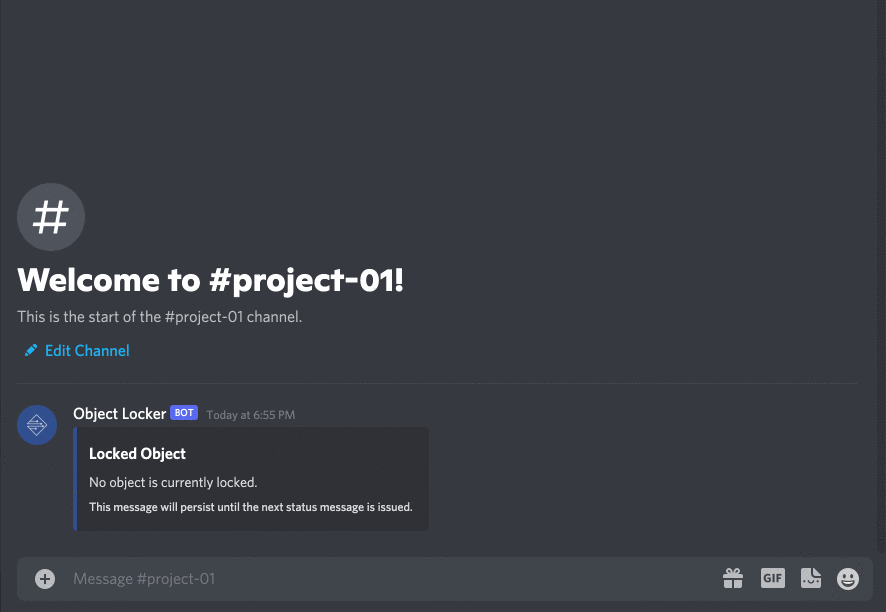
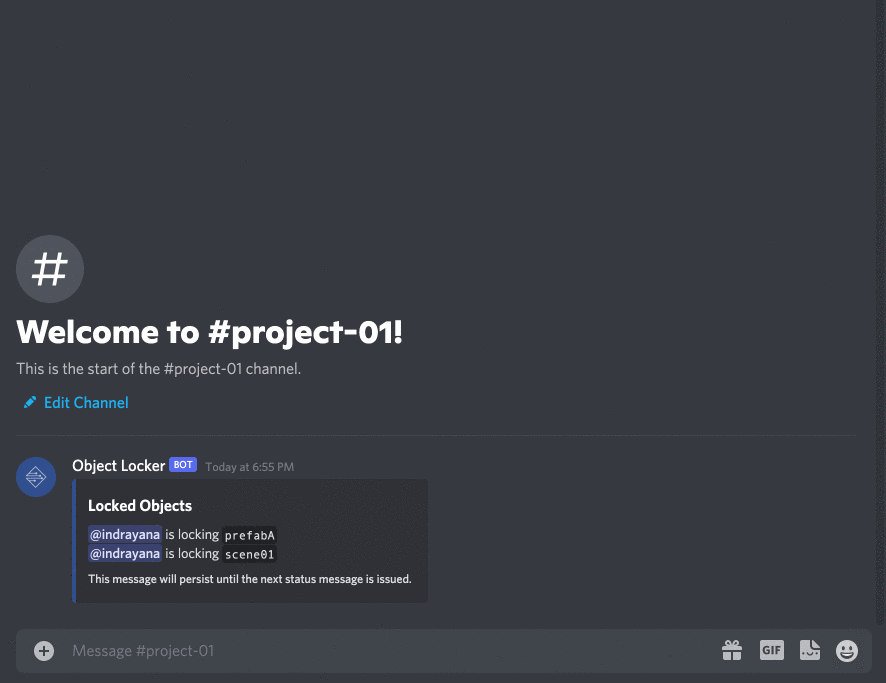
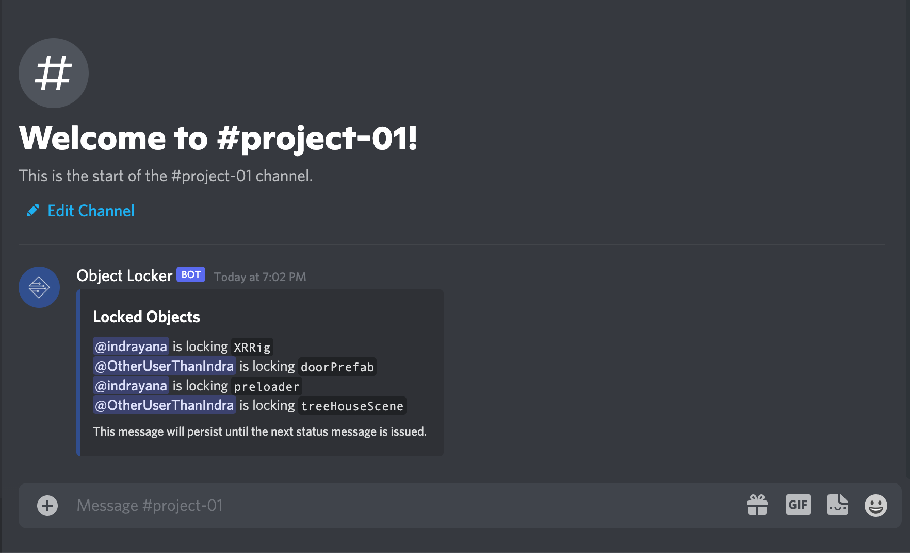

# Say :wave: to Object Locker

## I am a Discord bot trying to help avoid merge conflicts in (Game) Dev Teams :innocent:

[Discord Bot Invite Link](https://discord.com/api/oauth2/authorize?client_id=860802950099107870&permissions=19456&scope=bot%20applications.commands)

If you're using `git` as your version control and want to work on non-mergeable object, like `Unity Scenes` or `Prefabs`, you can definitely use me to tell all of the team members that you're working on them!

You can call me in an already existing channel (or dedicated) for your project. If you're working on multiple projects, you can call me in multiple channels without polluting the lock status of other projects! *p.s. I also keep the channel tidy!*

Try using `/lock yourSceneName` or `/lock scene01 scene02` to announce **I'M WORKING ON THIS :kissing_heart:**  
  

When you're finished, use `/unlock` or `/unlock sceneName` or even `/unlock scene01 scene02 prefabA` to say **I'M DONE WITH THE ONES I'M WORKING :sunglasses:**  

Whenever you want to know who is working on what on a project/channel, use `/lockstatus`  
If you're feeling curious, you can use `/lockstatus server:True` to see all locked objects in the whole server (only you will see that reply).  

Don't understand something? Type `/` and Discord will show what each of my commands does, or use `/about`!

Written using Discord.JS v14  
Made with love by [indrayana.net](https://github.com/made-indrayana) © 2021

## Running your own copy

Requires Node 22 or newer.

1. `npm install`
2. Create a `.env` with `DISCORD_TOKEN` and `CLIENT_ID` (plus `GUILD_ID` for development deploys).
3. Register the slash commands: `npm run deploy-cmd` (only in the `GUILD_ID` guild, instant) or `npm run deploy-cmd:global` (every guild). Pick one, or commands show up twice. Re-run after changing a command's definition.
4. `npm start` (or `npm run dev` for auto-restart). Locks are stored in `database.sqlite` in the working directory, so keep it on persistent storage.

The bot only needs the `Guilds` gateway intent, so no privileged intents have to be enabled in the developer portal. It needs the View Channel, Send Messages and Embed Links permissions in the channels you use it in.
